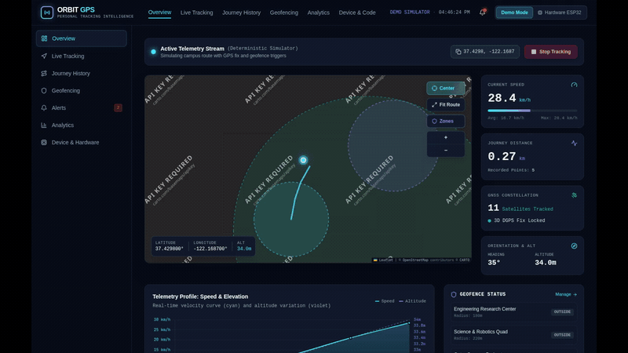
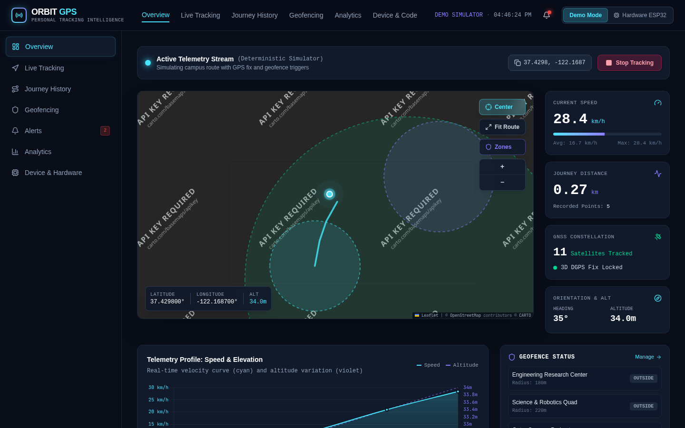
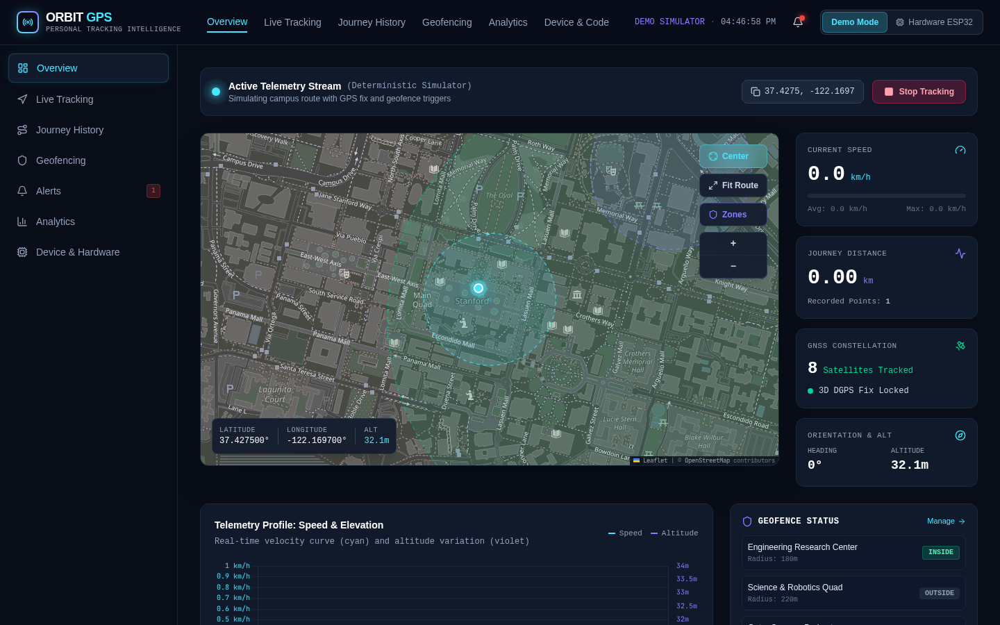
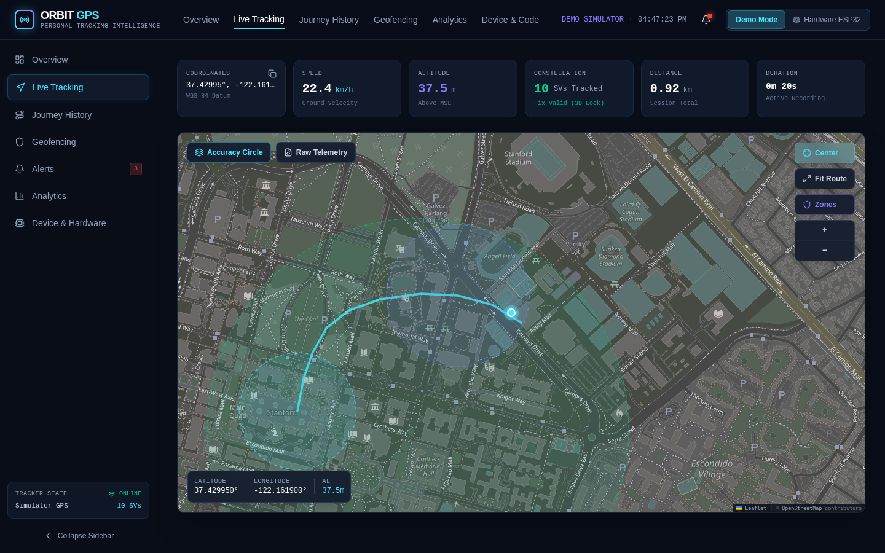
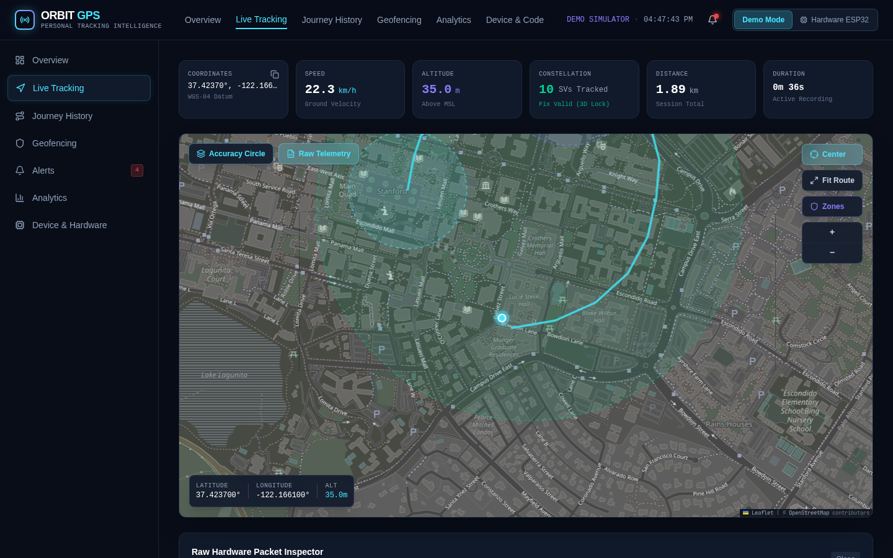
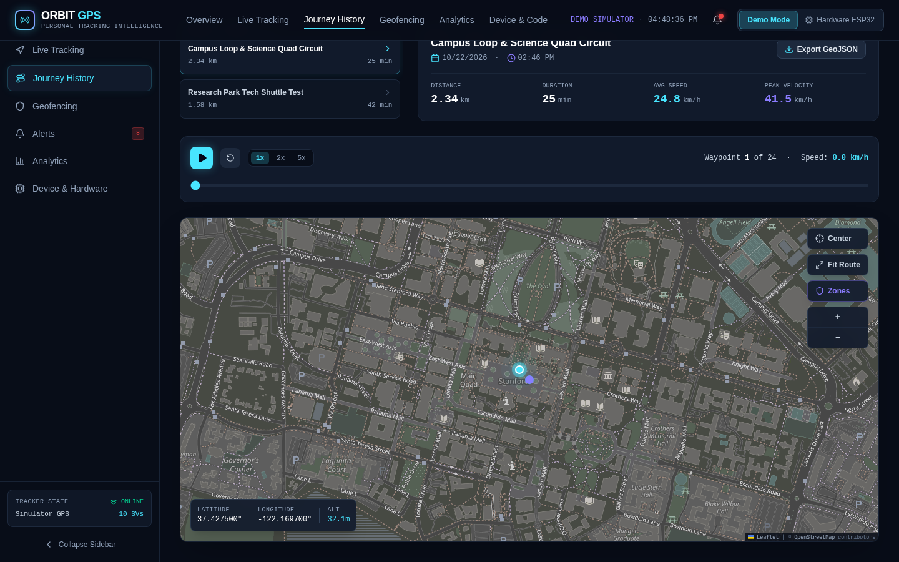
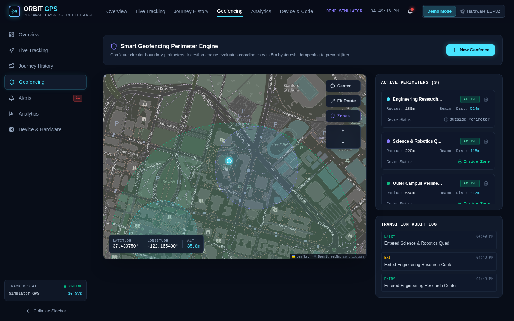
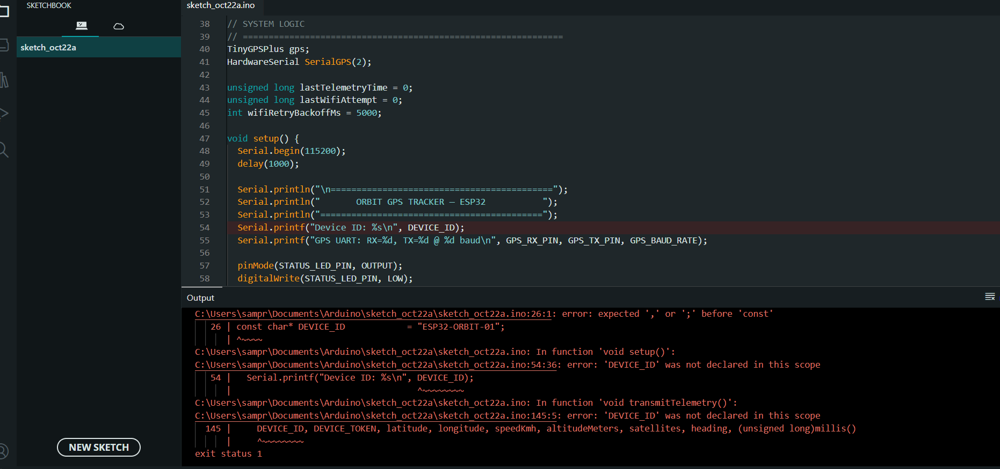

# ORBIT GPS — Personal Tracking Intelligence

[](https://opensource.org/licenses/MIT)
[](https://www.espressif.com/)
[](https://www.u-blox.com/)
[](backend/)
[](src/)
[](https://leafletjs.com/)

A high-precision personal IoT GPS Tracker and navigation dashboard engineered for the **ESP32-WROOM-32** development board and **u-blox NEO-6M** GNSS receiver module. 

Features a dark aerospace-inspired dashboard, real-time Leaflet tracking map, smart geofencing with hysteresis dampening, interactive journey history playback, telemetry analytics, and direct hardware diagnostics via Web Serial API and Flask REST endpoints.

---

## 📹 Video Demonstration & Live Preview

### System in Action (Hardware + Web Dashboard)



> 🎥 **Full Video File Included**: You can watch or download the full high-definition video directly from the repository:  
> [👉 **Download / View `docs/assets/orbit-tracker-demo.mp4`**](docs/assets/orbit-tracker-demo.mp4)

---

## 🚀 Pushing This Repository to GitHub

You can publish this entire project (including all source code, ESP32 firmware, Flask backend, screenshots, and demo video) to your GitHub account using either our automated scripts or standard Git commands.

### Option A: One-Click Script (Recommended)

#### On Windows:
Double-click `push_to_github.bat` or run in Command Prompt / PowerShell:
```cmd
push_to_github.bat https://github.com/YOUR_USERNAME/YOUR_REPOSITORY.git
```

#### On Linux / macOS / Git Bash:
```bash
chmod +x push_to_github.sh
./push_to_github.sh https://github.com/YOUR_USERNAME/YOUR_REPOSITORY.git
```

---

### Option B: Step-by-Step Git Commands

1. **Create a new empty repository on GitHub**:
   - Go to [github.com/new](https://github.com/new)
   - Repository name: `ORBIT-GPS-Tracker`
   - Set visibility to **Public** (or Private)
   - Do **NOT** initialize with a README, .gitignore, or license (these are already configured in this repo).

2. **Run the following commands in your project folder**:
   ```bash
   # Initialize git (if not already done)
   git init

   # Stage all files (firmware, backend, frontend, docs, video, and assets)
   git add .

   # Commit the files
   git commit -m "feat: complete ORBIT GPS IoT tracker with ESP32 firmware, Flask backend, live tracking dashboard, and demo video"

   # Rename branch to main
   git branch -M main

   # Add your GitHub repository as remote origin
   git remote add origin https://github.com/YOUR_USERNAME/ORBIT-GPS-Tracker.git

   # Push code and demo assets to GitHub
   git push -u origin main
   ```

---

## 🎬 How to Add & Display Video on GitHub

GitHub provides multiple ways to showcase video demonstrations:

### Method 1: Included Animated GIF (Already Configured!)
The repository includes an optimized animated GIF at `docs/assets/orbit-tracker-demo.gif`. Because it is under 2MB, GitHub automatically renders and plays it directly on the repository homepage and README on both desktop and mobile browsers!

### Method 2: Embed Video via GitHub Web Editor (Permanent CDN Player)
To get GitHub's native video player with play/pause controls right inside your README:
1. Push your repository to GitHub.
2. In your browser on GitHub, navigate to your repository and click the **Pencil (Edit)** icon on `README.md`.
3. Drag and drop your `.mp4` or `.mov` video file into the markdown text area.
4. GitHub will upload it to its CDN and insert a tag like:
   ```markdown
   https://github.com/user-attachments/assets/xxxx-xxxx-xxxx
   ```
5. Click **Commit changes**. GitHub will now display an interactive video player inside your README!

### Method 3: GitHub Releases (Best for Full Uncompressed Videos)
1. On your GitHub repository page, click **Releases** (right sidebar) -> **Draft a new release**.
2. Tag version: `v1.0.0`, Title: `v1.0.0 — Working Hardware Prototype & Live Telemetry`.
3. Attach your video file under **Attach binaries by dropping them here**.
4. Click **Publish release**. Anyone can now download or stream your full video demonstration!

---

## 📸 Interface & Hardware Showcase

| 🛰️ Live Telemetry Dashboard | 🗺️ Real-time Map & Waypoint Tracking |
|:---:|:---:|
|  |  |

| ⏱️ Journey History Playback | 🛡️ Smart Geofencing & Radar Perimeters |
|:---:|:---:|
|  |  |

| 🚨 System Safety & Event Audit Log | 📈 Velocity & Altitude Telemetry Analytics |
|:---:|:---:|
|  |  |

| 🔌 Hardware Diagnostics & Direct Web Serial | 💻 Live Satellite Acquisition in VS Code |
|:---:|:---:|
|  |  |

---

## 🛠️ Hardware Architecture & Wiring

### Bill of Materials
- **Microcontroller**: ESP32-WROOM-32 Development Board (30 or 38-pin)
- **GPS Receiver**: u-blox NEO-6M GNSS Breakout Module with Ceramic Patch Antenna
- **Prototyping**: Solderless Breadboard & 4x Male-to-Female / Male-to-Male Jumper Wires
- **Host Machine**: Windows / Mac / Linux Computer with Wi-Fi & USB Port

### Circuit Schematic & Pin Mapping

```
  +----------------------+                 +----------------------+
  |    ESP32-WROOM-32    |                 |   u-blox NEO-6M GPS  |
  |                      |                 |                      |
  |      GPIO 16 (RX2)   |<----------------| TX (Transmit)        |
  |      GPIO 17 (TX2)   |---------------->| RX (Receive)         |
  |      GND             |-----------------| GND (Ground)         |
  |      3.3V or 5V(VIN) |-----------------| VCC (Power)          |
  +----------------------+                 +----------------------+
```

> ⚠️ **Power Note**: Most NEO-6M breakout boards include an onboard 3.3V LDO regulator and accept **5V (VIN)** or **3.3V**. Ensure firm jumper contact on the breadboard.

---

## 💻 Quickstart Setup Guide

### 1. Find Your Laptop's Local Wi-Fi IP Address
Because the ESP32 is a standalone client on your Wi-Fi network, it needs your computer's local IP address rather than `localhost`:
- **Windows**: Open `cmd` or `PowerShell`, type `ipconfig`, and find your Wi-Fi IPv4 address (e.g. `192.168.1.150`).
- **macOS / Linux**: Open Terminal and run `ifconfig | grep "inet "` or `ip a`.

---

### 2. Start the Python Flask Backend
In your terminal:
```bash
cd backend
python -m venv venv

# Windows:
venv\Scripts\activate
# Linux/macOS:
source venv/bin/activate

pip install -r requirements.txt
python app.py
```
The REST API will start on `http://0.0.0.0:5000` and automatically create/migrate `orbit_gps.db`.

To run backend test suites:
```bash
python test_app.py
```

---

### 3. Flash the ESP32 Firmware

1. Install **Arduino IDE** (version 2.x).
2. Add ESP32 board support via *File -> Preferences -> Additional Boards Manager URLs*:  
   `https://raw.githubusercontent.com/espressif/arduino-esp32/gh-pages/package_esp32_index.json`
3. Install the **TinyGPSPlus** library by Mikal Hart via *Tools -> Manage Libraries...*
4. Open `firmware/esp32_gps_tracker.ino`.
5. Update your Wi-Fi credentials and laptop server URL in `firmware/config.example.h` (or copy to `config.h`):
   ```cpp
   const char* WIFI_SSID            = "Your_WiFi_SSID";
   const char* WIFI_PASSWORD        = "Your_WiFi_Password";
   const char* SERVER_TELEMETRY_URL = "http://192.168.1.150:5000/api/telemetry";
   const char* DEVICE_TOKEN         = "orbit_secret_token_2026";
   ```
6. Connect your ESP32 via USB, select **ESP32 Dev Module** and the correct COM port, and click **Upload**.
7. Open Serial Monitor at **115200 baud** to verify satellite lock status.

---

### 4. Launch the Web Dashboard

In the root directory:
```bash
npm install
npm run dev
```
Open **http://localhost:3000** in your browser.

---

## 📡 Live Telemetry vs Demo Mode

- **Demo Mode**: Simulates realistic vehicle or person movement across a campus route with dynamic velocity curves, satellite count changes, and perimeter crossing triggers.
- **Hardware Mode**: Connects directly to your local Flask backend or via the browser's native **Web Serial API** (USB direct connection). When the physical ESP32 is powered on and locked, genuine GPS NMEA data streams live onto the map.

---

## 🛰️ GPS Troubleshooting & Satellite Lock

- **Solid Red LED on NEO-6M**: The GPS board has power and is searching for satellite orbits.
- **Blinking 1Hz Red LED on NEO-6M**: 3D Satellite Lock is **acquired** ($\ge 4$ satellites locked).
- **Cold Start Indoors**: GPS satellite radio signals at 1.5 GHz cannot easily penetrate thick concrete or metal roofs. Place the antenna near an open window or outdoors with an unobstructed view of the sky during initial satellite acquisition (takes ~45–90s).

---

## 📚 REST API Reference

| Method | Endpoint | Description |
|---|---|---|
| `GET` | `/api/health` | Service health check and server time |
| `POST` | `/api/telemetry` | Ingests GPS point (authenticated by token) |
| `GET` | `/api/telemetry/latest` | Returns most recent valid GPS coordinate |
| `GET` | `/api/history` | Historical coordinates by session/time range |
| `GET` | `/api/analytics` | Aggregated metrics (distance, speed, duration) |
| `GET` | `/api/geofences` | Lists all active geofence boundaries |
| `POST` | `/api/geofences` | Creates a new circular geofence |
| `DELETE` | `/api/geofences/<id>` | Deletes an active geofence |
| `GET` | `/api/events` | Retrieves system security and boundary alerts |
| `POST` | `/api/events/<id>/acknowledge` | Acknowledges an alert event |
| `GET` | `/api/device/status` | Current connection and fix status |

---

## 🧪 Testing

- **Geospatial & Mathematical Logic Tests** (TypeScript with `node:test`):
  ```bash
  npx tsx --test src/utils/geo.test.ts
  ```
- **Backend API & Database Tests** (Python `unittest`):
  ```bash
  python3 backend/test_app.py
  ```

---

## 📄 License

MIT License. Engineered for IoT embedded systems education, hardware prototyping, and real-time navigation intelligence.
